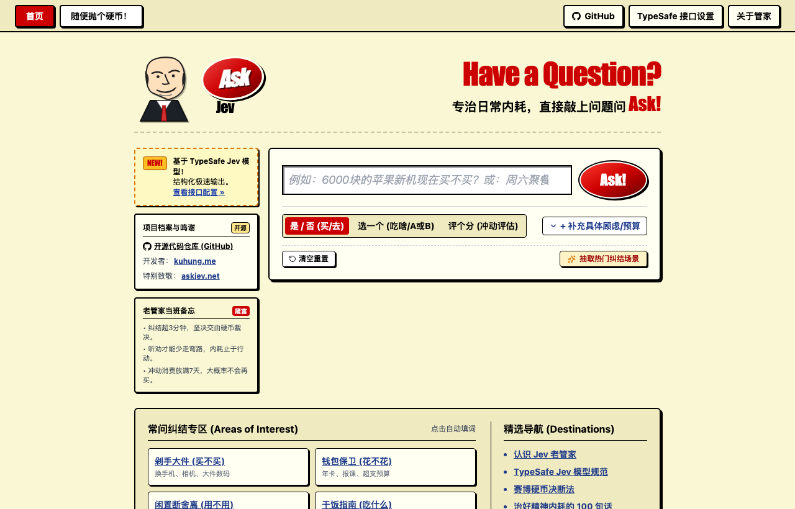

<div align="center">

# Ask Jev (问问 Jev)

**A retro 90s Neo-Brutalist micro-decision butler powered by single-step Jev primitives (`noul`, `choice`, `score`) — instant, decisive verdicts for everyday dilemmas.**

[English](README.md) | [中文](README_ZH.md)

[](https://askjev.kuhung.me)
[](https://jev.kuhung.me)

</div>

<p align="center">
  <a href="https://askjev.kuhung.me">
    
  </a>
</p>

---

## How It Works

Instead of asking a slow LLM to write a balanced essay about whether you should buy a new phone or what to eat for lunch, **Ask Jev** maps everyday dilemmas directly onto three single-step decision primitives:

- **Yes / No (`noul`)** — "Should I buy it / go tonight?" → crisp binary verdict with confidence.
- **Pick One (`choice`)** — "A or B / what's for lunch?" → selects one option from your candidates.
- **Impulse Score (`score`)** — rates how rational or impulsive a choice is on a discrete scale.

Built with a 90s Ask Jeeves homage aesthetic (cream ground, thick hard-shadow borders, SVG butler portrait, one-click verdict quote copy, and confetti lock-in). Works out of the box with a built-in fallback engine even without an external API key.

---

## Quick Start

```bash
git clone https://github.com/kuhung/ask-jev.git
cd ask-jev
npm install
npm run dev
```

Open `http://localhost:3000`. Want zero setup? Double-click the standalone [`index.html`](index.html) at the repository root.

### Optional: Connect a Live TypeSafe Jev Endpoint (Vercel / `.env.local`)

| Variable | Description |
|---|---|
| `TYPESAFE_JEV_ENDPOINT` | Server-side Jev decision API endpoint URL |
| `TYPESAFE_JEV_API_KEY` | Server-only API key (never exposed to the browser) |

If omitted, the `/api/jev` route gracefully falls back to the built-in local decision engine (`lib/mockJev.ts`) so the app stays playable anywhere.

---

## Related & Credits

- **Technical deep dive on how Jev works under the hood**: [kuhung/understanding-jev](https://github.com/kuhung/understanding-jev) ([jev.kuhung.me](https://jev.kuhung.me))
- **Built by**: [kuhung.me](https://kuhung.me)
- **Inspiration**: [askjev.net](https://askjev.net) & 1990s Ask Jeeves
