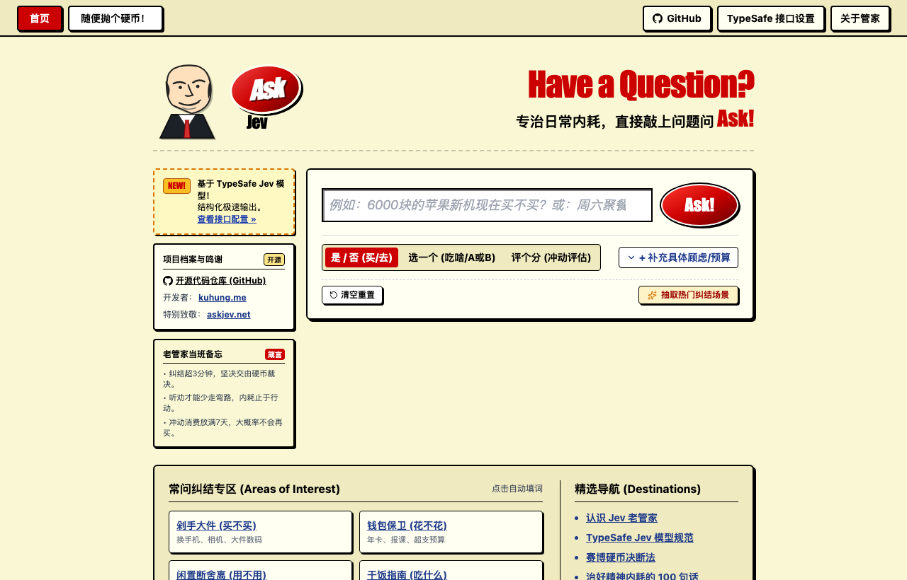

<div align="center">

# 问问 Jev (Ask Jev)

**复古 90 年代新野蛮主义（Neo-Brutalism）生活微决策老管家——把日常纠结直接映射到单步 Jev 决策原语，干脆利落给结论。**

[English](README.md) | [中文](README_ZH.md)

[](https://askjev.kuhung.me)
[](https://jev.kuhung.me)

</div>

<p align="center">
  <a href="https://askjev.kuhung.me">
    
  </a>
</p>

---

## 为什么做这个小工具

遇到「买不买」「去不去」「中午吃什么」这种日常微决策，问常规大模型往往换来一堆“一方面…另一方面…”的废话。**问问 Jev** 直接把生活纠结对应到三种单步判别原语：

- **是 / 否（`noul`）** — 买不买、去不去、花不花，直接拍板给结论；
- **选一个（`choice`）** — 吃啥 / A 还是 B，从候选里干脆挑一个；
- **评个分（`score`）** — 给冲动消费或纠结念头打离散分数。

视觉致敬 90 年代经典的 Ask Jeeves（奶黄底色、粗黑硬阴影边框、矢量老管家肖像、裁决金句一键复制与撒花锁定）。即使不配外部 API Key，内置本地推演引擎也能开箱即玩。

---

## 本地运行与一键部署

```bash
git clone https://github.com/kuhung/ask-jev.git
cd ask-jev
npm install
npm run dev
```

浏览器打开 `http://localhost:3000` 即可体验；不想装依赖也可以直接双击根目录的单页文件 [`index.html`](index.html)。

### 可选：接入真实 TypeSafe Jev 接口（Vercel / `.env.local`）

| 环境变量 | 说明 |
|---|---|
| `TYPESAFE_JEV_ENDPOINT` | 服务端 Jev 决策接口地址 |
| `TYPESAFE_JEV_API_KEY` | 仅存服务端的访问密钥（绝不暴露到前端） |

未配置时，`/api/jev` 会自动平滑降级到内置本地推演引擎（`lib/mockJev.ts`），保证线上始终可用。

---

## 延伸阅读与鸣谢

- **配套原理长文与万次压测**：[kuhung/understanding-jev](https://github.com/kuhung/understanding-jev)（[jev.kuhung.me](https://jev.kuhung.me)）
- **作者主页**：[kuhung.me](https://kuhung.me)
- **灵感致敬**：[askjev.net](https://askjev.net) 与 90 年代经典 Ask Jeeves
